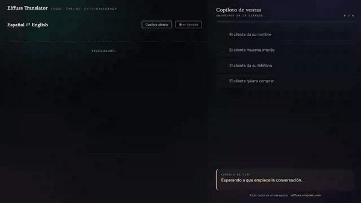

<div align="center">

# Elffuss Translator

**Traducción de conversaciones en tiempo real, 100 % en tu navegador.**

Escucha, distingue quién habla, traduce y responde por voz.
Sin servidor, sin cuenta, sin API de pago — nada de lo que digas sale de tu máquina.

[**▶ Abrir la app**](https://translator.elffuss.utopiaia.com) · [Elffuss](https://elffuss.utopiaia.com) · Apache-2.0

</div>

---

## El copiloto en vivo

El translator no solo traduce: puede **pasarle la conversación a [Elffuss Claw](https://github.com/KikoCis/elffuss-claw)**, que actúa de copiloto y te va soplando qué decir mientras hablas. Un vendedor habla español, el cliente inglés, y en la otra ventana los objetivos de la llamada se van cumpliendo solos.



<div align="center"><sub>

Demo guionizada para enseñar el flujo · [vídeo completo con audio](docs/demo.mp4)

</sub></div>

Los dos dominios son distintos, así que la tubería va por `postMessage` con validación de origen: el translator manda cada intervención (`[Hablante N] …`), Claw responde con una línea accionable y el estado de los objetivos, y el consejo vuelve a aparecer sobre los subtítulos.

## Qué hace

- **Modo conversación**: un solo micrófono, manos libres. Detecta los turnos por energía, separa **quién habla** por su voz y enruta cada turno al idioma del otro.
- **Subtítulos** con el original y la traducción debajo, creciendo hacia abajo como en una llamada real.
- **Voz**: lee la traducción en alto — o la silencias con un botón y sigue traduciendo y subtitulando igual.
- **Medio dúplex**: mientras habla, no se escucha a sí mismo. Sin esto, entra en bucle traduciendo su propia voz.
- **Ahorro de batería**: en segundo plano se pausa; al volver, se recupera solo.
- **Offline de verdad**: descargas los modelos una vez, quedan cacheados y luego funciona sin red.

## El stack, todo ONNX en el navegador

| Pieza | Modelo |
|---|---|
| **ASR** | `whisper-base` (WebGPU con caída a WASM) |
| **Diarización** | `pyannote-segmentation-3.0` (habla/silencio) + `wespeaker-voxceleb-resnet34-LM` (embeddings de hablante) |
| **Traducción** | Translator API on-device del navegador, con `opus-mt` (transformers.js) de reserva |
| **Voz** | `speechSynthesis` del sistema |

Corre sobre [transformers.js](https://github.com/huggingface/transformers.js) y ONNX Runtime Web. Sin framework y sin *build*: HTML y ES modules, se sirve como ficheros estáticos.

## Cómo funciona la diarización

`diarize.mjs` es autónomo y se puede usar suelto:

```js
import { loadDiarizer, diarize, makeSpeakerBook } from './diarize.mjs';

const D = await loadDiarizer(transformers, { device: 'webgpu' });

// (a) troceado por turnos de un audio ya grabado
const turns = await diarize(D, audio16k);   // [{ start, end, speaker }]

// (b) en vivo: asigna cada fragmento a un hablante estable
const book = makeSpeakerBook({ tau: 0.5, maxSpeakers: 2 });
const { label } = book.assign(await speakerVec(D, fragmento16k)); // 'S1' | 'S2'
```

Segmentación → embeddings por sub-ventana → agrupación por coseno. Dos fragmentos del mismo hablante rondan 0.8 de similitud; de hablantes distintos, ~0.15.

## Bordes honestos

- **La primera carga son megas.** Le mandas el modelo al usuario una vez; después vive en caché.
- **Separar voces simultáneas en un micro mono no es fiable**: el hablante más fuerte domina el embedding. La diarización **por turnos** sí funciona; para solapamiento real hace falta una captura por interlocutor.
- **Whisper alucina con el silencio.** Hay un umbral de energía y un filtro de muletillas típicas ("Subtítulos por…"), pero alguna se cuela.
- **Chrome/Edge** para WebGPU. Sin él cae a CPU y va más lento.
- La calidad de la voz es la del sistema operativo, que varía bastante entre idiomas.

## Ficheros

| | |
|---|---|
| `index.html` | La app completa: UI, captura, pipeline y tubería con Claw. |
| `diarize.mjs` | Motor de diarización (segmentación + embeddings + clustering). |

## Servirlo tú mismo

Son ficheros estáticos; cualquier servidor vale. Un único cuidado: **los `.mjs` deben servirse como JavaScript**, o el navegador bloquea el módulo. En nginx:

```nginx
location ~ \.mjs$ { default_type text/javascript; }
```

Y conviene servirlo por HTTPS: el micrófono y WebGPU lo exigen fuera de `localhost`.

## Licencia

Apache-2.0.
